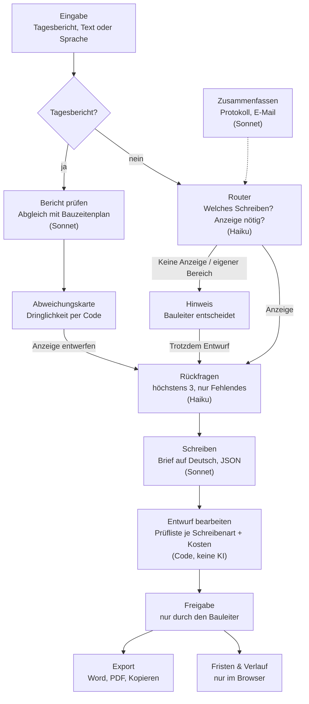

# Architektur

- Jeder KI-Schritt ist eine API-Route mit eigenem XML-Prompt aus `/prompts` und liefert JSON.
- Keine Datenbank. Projektdaten und Bauzeitenplan liegen als JSON in `/data`; Freigaben und Verlauf nur im Browser.
- Beispielmodus (`?beispiel=1`): Jeder Schritt antwortet mit vorbereiteten Daten aus `data/mocks/`, ohne KI.
- Baufrist versendet nichts. Ein Schreiben bleibt Entwurf, bis der Bauleiter es freigibt.
